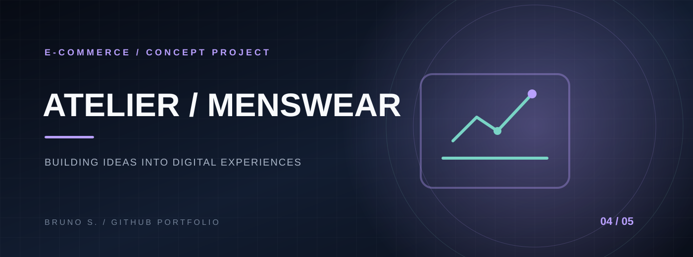

<div align="center">



# ATELIER / MENSWEAR
### E-COMMERCE / CONCEPT PROJECT

Conceito de e-commerce de moda masculina, com direção visual editorial e foco em catálogo, descoberta de produtos e navegação responsiva.

[](https://github.com/brunosg24/loja-de-roupa-masculina)


</div>

---

## ✦ Visão do projeto

Conceito de e-commerce de moda masculina, com direção visual editorial e foco em catálogo, descoberta de produtos e navegação responsiva.

## ◈ Recursos / escopo

Escopo planejado: catálogo, detalhes de produtos, busca, filtros e carrinho.

## ⌘ Tecnologias

Stack a definir durante a implementação

## ▶ Começar

```bash
git clone https://github.com/brunosg24/loja-de-roupa-masculina.git
cd loja-de-roupa-masculina
```

Os próximos passos de implementação serão documentados conforme o desenvolvimento avançar.

## 🧭 Próximos passos

- [ ] Evoluir a estrutura e os componentes do projeto.
- [ ] Melhorar experiência em dispositivos móveis.
- [ ] Documentar decisões técnicas e arquitetura.
- [ ] Adicionar testes e validações conforme as funcionalidades forem implementadas.

## ⚑ Status e transparência

Projeto em planejamento; ainda não possui implementação funcional.

<div align="center">

**BRUNO S.** · [GitHub](https://github.com/brunosg24)

</div>
